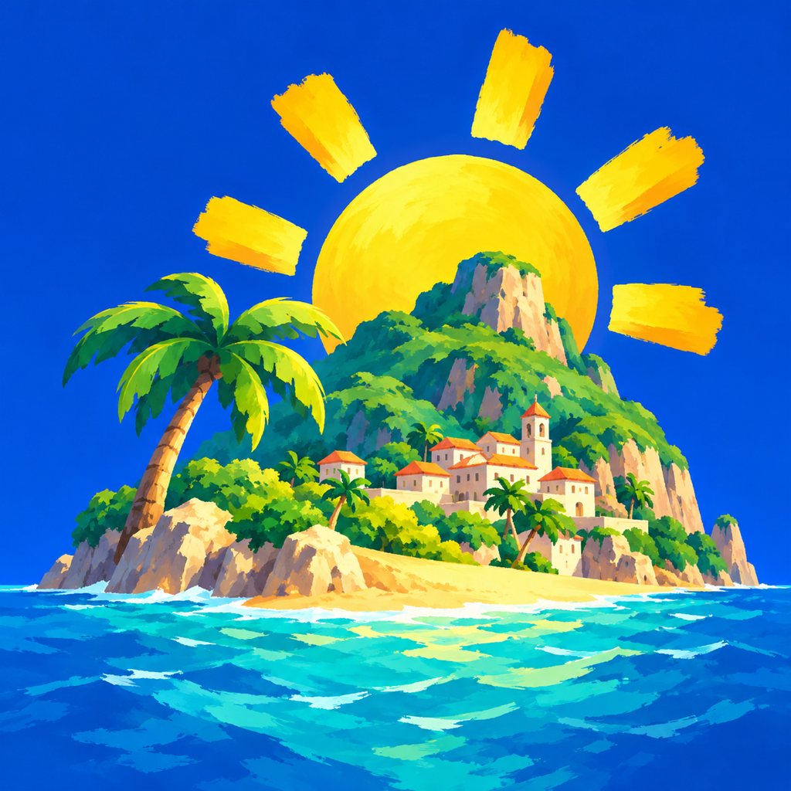

# SunPad

<p align="center">
  
</p>

<p align="center">
  
  
  
  
  
  <a href="https://github.com/chrissotraidis/padmint"></a>
  <a href="https://discord.gg/xwHfUD2bxW"></a>
</p>

**Super Mario Sunshine on iPhone and iPad, running the game's decompiled code natively.**
SunPad brings touch controls, controller support, rumble and local game-image
import to the Super Mario Sunshine decompilation. Supply your own supported copy
of the game.

Since 0.4.0, SunPad's engine is [sms-pc-port](https://github.com/chasem-dev/sms-pc-port)
by chasem-dev and contributors (MIT), which compiles the
[Super Mario Sunshine decompilation](https://github.com/chasem-dev/sms-english)
(from [doldecomp/sms](https://github.com/doldecomp/sms), CC0) as native code. SunPad
keeps a [maintained fork](https://github.com/chrissotraidis/sms-pc-port) on the
`sunpad` branch that adds an embedded build for Apple apps, and draws through
[MoltenVK](https://github.com/KhronosGroup/MoltenVK) to Metal. SunPad provides the
iPhone and iPad app. See [full credits](CREDITS.md), including AI and artwork
provenance.

SunPad 0.3.x ran a different engine: the game's PowerPC code translated ahead of
time on a Dolphin-derived runtime (ModernGekko). The
[legacy engine record](docs/LEGACY-ENGINE.md) describes it and how to bring it back.

> [!NOTE]
> **AI disclosure:** SunPad uses substantial AI assistance for code, tests,
> documentation, debugging and maintenance. Some support replies and maintenance
> tasks are automated. There is no audited percentage of AI-generated code.
> Build, test and device records describe what was checked. This disclosure
> concerns SunPad's workflow, not the authorship of its upstream projects.

## Get SunPad

The app on the [releases page](https://github.com/chrissotraidis/sunpad/releases/latest)
contains no game code. Its engine is compiled from decompiled game code, so it
can't be published: [PadMint](https://github.com/chrissotraidis/padmint) builds it
on your own Mac.

You need an Apple silicon Mac with full Xcode and its iOS platform, and
[Homebrew](https://brew.sh). Once, in Terminal:

```sh
brew install cmake ninja llvm
```

Then download [PadMint](https://github.com/chrissotraidis/padmint/releases/latest),
unzip it and double-click `PadMint.command`. In the PadMint page that opens in your
browser, choose SunPad and click **Make my copy**. PadMint builds the engine,
adds it to the published app and saves your SunPad IPA in your Downloads folder.
Install it with AltStore Classic, SideStore or Sideloadly. The IPA contains the
compiled game code: keep it for yourself.

Open SunPad and choose your own disc image: **••• → Game Data → Import or
Reimport Game Data**.

**Upgrading from 0.3.x:** install over the existing app with the same signing
setup. Your saves and settings carry over on first launch, and the old save
files stay as they were. Remove Stored Game Data or a reimport frees the
extracted copy 0.3.x kept (about 1.4 GB).

**Not in 0.4.0:** PadMint builds the new engine only on Apple silicon Macs, so
Windows and Linux PCs can't make SunPad 0.4.0 yet. The Mac app and the Apple TV
app are not available on the new engine yet. Copies of 0.3.x keep working.

## Current status

On 23 to 28 November 2026, on an iPhone 14 (A15) and a 12.9-inch iPad Pro (M2),
SunPad 0.4.0's engine:

- held 30 FPS (33.4 ms per frame) in Delfino Plaza, Bianco Hills and a
  maintainer's play session, at 1x on the iPhone and 2x and 4x on the iPad.
- made shaders the device had not seen before in the background, so a first
  visit to an area shows new objects a moment late instead of stopping.
- updated a 0.3.x install in place on the iPad, where its saves migrated byte
  for byte and a 94-Shine file loaded in game, and saved and reloaded a new
  file there.

The legacy engine ran the iPhone 14 at 23 to 27 FPS. Short hitches (up to about
230 ms) remain when an area loads. **Original 30 FPS is the supported default.**
See [known issues](docs/KNOWN_ISSUES.md) and [testing evidence](docs/TESTING.md).

## Frequently asked questions

<details>
<summary><strong>Is this emulation? Does it use Dolphin or a JIT?</strong></summary>

No. The game's code comes from the Super Mario Sunshine decompilation, compiled
ahead of time as native arm64 code like any app. sms-pc-port replaces the
GameCube's hardware and SDK with its own renderer, audio mixer and services, and
SunPad's fork draws through MoltenVK to Metal. Nothing is translated or
interpreted while you play, and SunPad 0.4.0 contains no Dolphin code.

The decompilation matches about 73% of the game's functions byte for byte and
99.6% approximately ([progress](https://github.com/chasem-dev/sms-english/blob/main/PROGRESS.md)),
so a rare difference from the original game is possible. Report one with a
screenshot. See the [architecture](docs/ARCHITECTURE.md).

</details>

<details>
<summary><strong>Which game image do I need, and how do I import it?</strong></summary>

Use your own **Super Mario Sunshine USA, revision 0 (`GMSE01`)** raw ISO/GCM
image. Other regions, revisions, modified images and compressed formats are not
supported. The exact image hash is in [game-data provenance](docs/LEGAL_AND_PROVENANCE.md).

On iPhone or iPad, open **••• → Game Data → Import or Reimport Game Data** and
select the image in Files, or copy it into SunPad's folder in Files and use
**Import from SunPad Folder**. SunPad checks the image and keeps a private copy,
which the engine reads directly. A failed reimport keeps the previous working data.
Removing stored game data asks first and never touches saves.

SunPad does not download games. Never attach game images, saves or builds to an
issue or pull request.

</details>

<details>
<summary><strong>How do controls and settings work?</strong></summary>

Touch controls provide movement, camera, D-pad, face buttons and analog FLUDD
pressure. Slide along **R** for more pressure and into its final quarter for a
full press. **••• → Controls** opens touch-layout settings and controller mapping.
A connected controller can hide the touch overlay automatically.

**••• → Display** holds Render Resolution (applied at once), Aspect Ratio and
Frame Rate (applied after reopening) and the FPS counter. See the
[control guide](docs/CONTROLS.md).

</details>

<details>
<summary><strong>Can I play at 60 FPS?</strong></summary>

**••• → Display → Frame Rate → 60 FPS (Experimental)** runs the engine's 60 FPS
mode, which corrects the game's timing. It needs about twice the work each
second, so a device that can't keep up plays slower. It has not been checked
hands-on yet: 30 FPS is the supported default.

</details>

<details>
<summary><strong>Will an update preserve my save?</strong></summary>

Update in place with the same app and signing identity. Uninstalling or changing
the bundle or signing can remove or disconnect local data, so export your saves
first (**••• → Saves → Export Saves…**). Never assume a reinstall restores a
save.

</details>

<details>
<summary><strong>Does LiveContainer work?</strong></summary>

LiveContainer is not a supported or verified install path. Use the normal signed
IPA installation in the [installation guide](docs/INSTALL_IPA.md). If reporting
a LiveContainer failure, include its copied launch error or crash report.

</details>

## Report a problem

Open **••• → Report a Problem…**, describe what happened, and review the diagnostic
report and GitHub draft before sharing. Include the device, app version, scene,
and reproduction steps. For visual issues, add a screenshot and the reviewed
`Latest-SunPad-Diagnostic.log` from SunPad's Files-visible `Diagnostics` folder.
The report includes the engine's log, which names each slow frame and its cause.

Never upload game data, saves, signing material, or a device container. If the app
cannot reopen, find its crash report under **Settings → Privacy & Security →
Analytics & Improvements → Analytics Data**. [Open a bug report](https://github.com/chrissotraidis/sunpad/issues/new?template=bug_report.yml).

## Build and contribute

[`.recomp.json`](.recomp.json) describes SunPad for project directories using
the [recomp.board format](https://recomp.fyi/spec). It contains public project
facts only, is maintained manually, and is not a build input.

Development uses an Apple silicon Mac, full Xcode (27.2 checked), Homebrew
LLVM, CMake, Ninja, Git and Python 3. In a clean checkout:

```sh
./scripts/bootstrap-dependencies.sh     # engine sources and MoltenVK, no game data
./scripts/check-repository.sh
./scripts/build-engine.sh iphonesimulator
```

Then build the `SunPad` scheme with `SUNPAD_EMBED_ENGINE=YES` to put a development
engine in the app. Game data is imported in the app as players do.

[Build instructions](docs/BUILDING.md) · [Contribution policy](CONTRIBUTING.md) ·
[Dependency pins](docs/DEPENDENCIES.md) · [Engine plan](docs/DECOMP-ENGINE-PLAN.md) ·
[Legacy engine](docs/LEGACY-ENGINE.md)

## Community and support

[Join the Discord](https://discord.gg/xwHfUD2bxW) for help and news. It is one
community for SunPad and its sibling projects, such as KartPad, BlueWake and
MeleePad: ask about setup, building with PadMint, and installing, share how it
runs on your device, and hear about new releases first.

Found a bug? [Open an issue](https://github.com/chrissotraidis/sunpad/issues)
with your device, its OS version, and the steps that led to it.

## License

SunPad is an unofficial community project, unaffiliated with Nintendo. Nintendo's
game, characters, artwork, and trademarks belong to their respective rights holders.
SunPad's app is [GPL-3.0-or-later](LICENSE). The engine and other components
retain their own licenses and attribution. See [third-party notices](THIRD_PARTY_NOTICES.md)
and [legal and provenance details](docs/LEGAL_AND_PROVENANCE.md).

## Legal

SunPad is an unofficial, fan-made project. It is not affiliated with, endorsed
by, or sponsored by Nintendo. Super Mario Sunshine and related names and marks
are trademarks of Nintendo (and their respective owners). This repository
contains no game data, disc images, or extracted assets. To use it, you need
your own legally obtained copy of the game, and you build it yourself on your
own machine. Please don't share game files or builds made from them.
