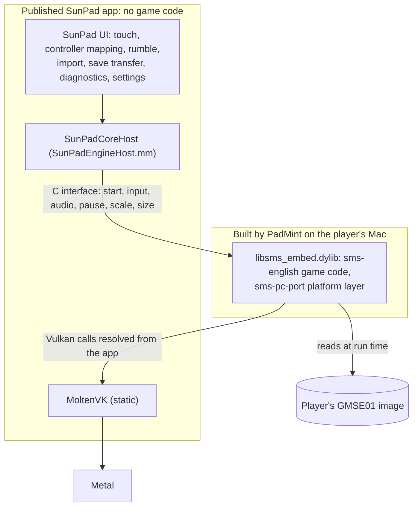

# Architecture

Last updated: 28 November 2026, for SunPad 0.4.0.

SunPad is an iPhone and iPad app around one engine, `libsms_embed.dylib`. The
engine is the Super Mario Sunshine decompilation compiled as native arm64 code,
with sms-pc-port's platform layer in place of the GameCube's hardware and SDK.
The published app contains everything except the engine. PadMint builds the
engine on the player's Mac and adds it to the app.

The legacy engine (0.3.x), which translated the game's PowerPC code ahead of
time and ran it on a Dolphin-derived runtime, is described in the
[legacy engine record](LEGACY-ENGINE.md).

## Overview



| Component | Where | Built by | Contents |
| --- | --- | --- | --- |
| Engine sources | [chrissotraidis/sms-pc-port](https://github.com/chrissotraidis/sms-pc-port), branch `sunpad`, gitlink `ref/sms-pc-port` with nested `decomp` and `sdk` ([pins](DEPENDENCIES.md)) | Upstream and the maintainer | The decompilation, the platform layer and a small SunPad patch series |
| Engine library | `Frameworks/libsms_embed.dylib` in the player's copy | `scripts/build-engine.sh`, run by PadMint | Game code and platform layer, compiled with Homebrew LLVM and the `gameptr` pass, debug information stripped |
| Host interface | `platform/embed/sms_embed.h` in the fork | Both sides | A versioned config struct and eight calls |
| App | This repository's `apple/` and `SunPad.xcodeproj` | The maintainer, published | UIKit app, MoltenVK, no game code |

## Host interface

The app owns the window, input, audio session and lifecycle. The engine owns
the game, its timing and its rendering. The app checks the interface version
before calling anything else, and says "Make your copy again with PadMint" when
the engine is missing a matching interface.

| Call | Purpose |
| --- | --- |
| `sms_embed_version()` | Interface version, checked first |
| `sms_embed_start(config)` | Disc image path, the `CAMetalLayer`, its drawable size, the app's `vkGetInstanceProcAddr` and a rumble callback |
| `sms_embed_set_pad(port, pad)` | Controller state in GameCube terms: sticks -100 to 100, analog triggers, PAD button bits |
| `sms_embed_set_scale(scale)` | Render Resolution, applied at the next frame |
| `sms_embed_pause(paused)` | Returns once the game has parked at its next frame with the GPU idle |
| `sms_embed_resize(width, height)` | Drawable size changes, rotation and external displays |
| `sms_embed_audio_pull(stream, bytes)` | The app's RemoteIO unit pulls 32 kHz interleaved stereo 16-bit samples |
| `sms_embed_stats(stats)` | Frames shown and the last present time |

The game runs until the process ends, as on the console, so there is no stop
call. New game data takes effect the next time SunPad opens.

## Inside the app

```text
SunPadAppDelegate            lifecycle, save grace on backgrounding
SunPadGameViewController     boot, game-data import, save import and export
  ├── SunPadMetalSurfaceView   CAMetalLayer the engine draws to
  ├── SunPadCoreHost           apple/ios/SunPadEngineHost.mm
  │     ├── dlopen libsms_embed.dylib, check sms_embed_version
  │     ├── SMS_* environment from SunPadEngineEnvironment (SunPadEngineBridge)
  │     ├── RemoteIO audio unit pulling sms_embed_audio_pull
  │     ├── SunPadEnginePad: SunPad input → GameCube pad
  │     └── twice a second: frame rate and drawable size
  └── SunPadGameOverlay        three-dot menu, touch controls, FPS counter
        └── SunPadInputState     touch and GameController merged (SunPadInputMixer)
```

`SunPadCoreHost.h` keeps the interface 0.3.x's host had, so the view
controller and overlay kept their wiring when the legacy engine was removed.
Its `gameRoot` argument is unused, and `modulePath` is the engine library.

**Settings.** The engine reads its settings from `SMS_*` environment variables,
some of them in the library's initializers, so the host sets them before it
loads the library. A variable already set (a developer launch or a test route)
wins over SunPad's choice.

| SunPad setting | Engine variable | When it applies |
| --- | --- | --- |
| Render Resolution 1× to 4× | `SMS_GX_SCALE`, then `sms_embed_set_scale` | At once |
| Aspect Ratio: Original 4:3, 16:9, Fill Screen | `SMS_WIDESCREEN`, `SMS_ASPECT` and `SMS_HEAT_HAZE` | Next launch |
| Frame Rate: 30 or 60 FPS | `SMS_FRAME_RATE` | Next launch |
| Controller Rumble | `SMS_RUMBLE` and the rumble callback | At once |

The host also sets fixed values: `SMS_RETAIL_UI=1` (the pause menu, movies and
HUD as the retail game shows them), `SMS_VK_ASYNC_PIPELINES=1` (new pipelines
made in the background), `SMS_GX_HITCH_MS=50` and `SMS_GX_STATS=300` (slow
frames and pipeline counts in the engine log), and texture packs, the GameCube
adapter, presence and the PC port's trackers off.

**Lifecycle.** Leaving the app, a call or another audio interruption pauses the
engine through `sms_embed_pause`, and returning resumes it. The app delegate
keeps the process alive briefly after it resigns active, so a save already under
way finishes.

## Data on the device

Everything lives in the app's container, under
`Library/Application Support/SunPad` unless noted.

| Path | Contents |
| --- | --- |
| `GameData/` | The player's imported disc image, checked by SHA-256 on import. A 0.3.x install also left an extracted tree in `GameData/GMSE01`, which Remove Stored Game Data or a reimport removes |
| `Engine/card-a/` | The engine's memory card (`SMS_SAVE_DIR`). The engine writes it with an atomic rename |
| `Engine/settings.txt` | The engine's own settings file (`SMS_SETTINGS`) |
| `GC/USA/Card A/` | 0.3.x's Dolphin GCI card. The first 0.4.0 launch copies its saves to `Engine/card-a` and never changes it |
| `Logs/` | `runtime.log`, the previous launch's log and `Engine.log` (the engine's stderr) |
| `Library/Caches` | The engine's Vulkan pipeline cache (`XDG_CACHE_HOME`) |
| `Documents/` | Files-visible: images to import from the SunPad folder, and `Diagnostics/Latest-SunPad-Diagnostic.log` |

Export Saves writes the engine's card as Dolphin GCI files, and Import Dolphin
Save stages a GCI file that replaces the save before the engine opens its card
at the next launch. See `SunPadEngineSaves` and `SunPadSaveTransfer` in
`apple/shared`.

## Memory layout

The game stores pointers in 32-bit slots. The engine's `gameptr` pass plugin
adds a fixed base to every integer the code turns into a pointer, so game
addresses from `0x80000000` live at `PORT_GAME_HI + x`. Device builds for
iPhone and iPad use `0x7000000000` (448 GiB), which fits the address space iOS
gives an app. Simulator builds run in the Mac's address space and keep the
macOS base. This is why the engine needs Homebrew's LLVM: Apple's Clang can't
load pass plugins.

## Repository layout

```text
sunpad/
  apple/ios/          UIKit app, engine host, overlay, Info.plist, assets
  apple/shared/       settings, input, controller mapping and rumble, saves,
                      diagnostics, engine bridge
  apple/macos/next/   a development Mac app on the engine (not published, see MACOS.md)
  SunPad.xcodeproj    the SunPad target (iPhone and iPad)
  scripts/            engine build, packaging, audits, checks, routes
  tests/              focused source tests (see TESTING.md)
  config/             the dependency lock
  docs/               documentation, including the legacy engine record
  ref/                the engine submodule and MoltenVK (MoltenVK and game data ignored)
```

## Separation rules

1. Game code, engine binaries, disc images, saves and logs never enter Git or
   a published file.
2. Engine changes live in the fork, as named commits that could go upstream.
3. The app talks to the engine only through `sms_embed.h`.
4. The published app and a player's copy differ only by
   `Frameworks/libsms_embed.dylib` and their signatures. `audit-ios-package.sh`
   checks both.
