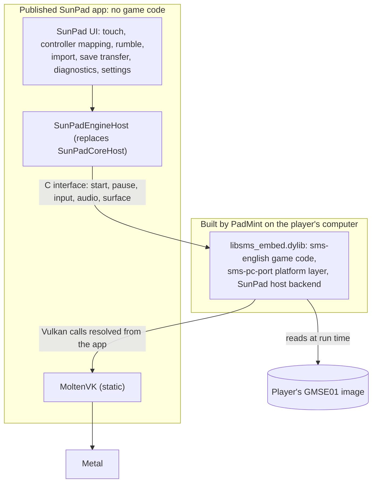

# SunPad decompilation engine plan

- **Date:** 2026-11-22
- **Status:** approved by the maintainer on 2026-11-23, with the recommended
  answer to every decision in [Decisions for the maintainer](#decisions-for-the-maintainer).
  Work is under way, and the [status table](#status) is current.
- **SunPad baseline:** `72c101a` on `main` (0.3.3, build 21)
- **Engine reviewed:** [chasem-dev/sms-pc-port](https://github.com/chasem-dev/sms-pc-port)
  `21d7b639a9041d4a656ea5e8b4bfe617ad4b8fba` (2026-11-17), with `decomp`
  ([sms-english](https://github.com/chasem-dev/sms-english))
  `967436b8c623834d38a57d34923775f45eca8861` and `sdk`
  ([sms-mod-sdk](https://github.com/chasem-dev/sms-mod-sdk))
  `0bdec6924ed63b6d0a426556293a83b6de300402`
- **Supersedes, once approved:** [Track 2](IMPROVEMENT-PLAN.md#track-2-a-decompilation-based-apple-port)
  of the improvement plan and the license findings of the
  [sms-pc-port review](SMS-PC-PORT-REVIEW.md)

SunPad moves its game engine from the ahead-of-time translated retail program
on the Dolphin-derived runtime to the Super Mario Sunshine decompilation,
compiled natively through a maintained fork of sms-pc-port. The SunPad app
stays: touch controls, controller mapping, rumble, Files import, save transfer,
diagnostics, the Apple TV shell and PadMint builds. The current engine keeps
shipping in the 0.3.x line until the new engine passes the acceptance gates in
this plan, and is then retired.

## Contents

- [Why](#why)
- [What changed since the October review](#what-changed-since-the-october-review)
- [Target architecture](#target-architecture)
- [What carries over, changes and retires](#what-carries-over-changes-and-retires)
- [Rules and documents that change on approval](#rules-and-documents-that-change-on-approval)
- [Decisions for the maintainer](#decisions-for-the-maintainer)
- [Status](#status)
- [Phases and task cards](#phases-and-task-cards)
- [Acceptance gates](#acceptance-gates)
- [Risks](#risks)
- [Schedule](#schedule)
- [Evidence recorded for this plan](#evidence-recorded-for-this-plan)

## Why

The current engine emulates GameCube hardware around translated PowerPC code.
Its own measurements put the worst iPhone 14 interval at 0.759 of full speed
with the game thread saturated, and spread the cost over translated code,
paired-single and quantized helpers, dispatch, memory translation, software
vertex loading and GPU readback waits
([performance research](APPLE-PERFORMANCE-RESEARCH.md),
[improvement plan goal 2](IMPROVEMENT-PLAN.md#goals)). The improvement plan
needs about 24% less work on the critical path just to reach full speed, and
the CPU/video split and the 90% clock were rejected for correctness.

The decompiled engine calls the game as native functions, uses host floating
point, and draws GX through its own renderer. On the maintainer's Mac it runs
the game far beyond 30 FPS:

| Build | Delfino Plaza tour, 1280x960, vsync off | Frame time |
| --- | --- | --- |
| sms-pc-port native arm64, Vulkan through MoltenVK | 434 FPS | 2.30 ms mean, 4.00 ms slowest 5% |
| sms-pc-port native arm64, OpenGL | 131 FPS | 7.65 ms mean |

Measured 2026-11-22 on an Apple M3 Max, macOS 27.2.1, Homebrew LLVM 22.1.8,
the maintainer's GMSE01 image, `tools/vulkan/bench.py --rounds 1 --scale 1`.
The 30 FPS frame budget is 33.3 ms. An A15 core is slower than an M3 Max core,
but the gap to the budget is about fourteen times, so frame-time headroom on an
iPhone 14 is expected. That expectation is unmeasured until task E1.4.

The engine was built for fidelity. Its matrix library follows the console's
paired-single routines instruction for instruction and its trigonometry follows
the game's own MSL routines, each checked bit for bit against the original
objects run under `qemu-ppc` on a million inputs per function
(sms-pc-port `docs/64-BIT.md`, items 10 and 11). Its card writes go through a
temporary file and a rename, and it repairs a cut-short save on load.

## What changed since the October review

The [October 7 review](SMS-PC-PORT-REVIEW.md#why-it-cannot-be-dropped-into-sunpad)
gave four reasons the port could not be used. The improvement plan's Track 2
listed matching conditions. Three no longer hold.

| October finding | Current state | Source |
| --- | --- | --- |
| No license | MIT, `Copyright (c) 2026 SoftwareAura LLC`, added 2026-10-13 in `f359091196`. The decompilation is CC0. The mod SDK is MIT | `LICENSE`, `decomp/LICENSE`, `sdk/LICENSE` |
| Apple arm64 cannot host the memory model | Native arm64 macOS plays. An LLVM pass (`tools/gameptr`) rebases every integer-to-pointer conversion into two high address windows, and pixel-compared captures match the x86_64 build | `docs/MACOS-ARM64.md`, measured build above |
| OpenGL is not an iOS option | A Vulkan backend renders through MoltenVK on macOS. The same author's `sms-iphone-ipad` boots to the airstrip with touch controls on a physical iPhone 15 Pro through static MoltenVK | `docs/VULKAN.md`, [sms-iphone-ipad](https://github.com/chasem-dev/sms-iphone-ipad) `docs/VALIDATION.md` |
| About a quarter of functions unmatched | Still true. 72.94% of functions are byte-identical and 99.57% fuzzy-match, with 33.18% source-linked. The port compiles the near-matching code, and it is played on Windows, Linux, macOS, Android and Switch | `decomp/PROGRESS.md` (2026-09-27) |

The fourth row is the remaining fidelity risk. The scene matrix in
[gate G3](#acceptance-gates) exists to catch it, and divergences go upstream as
reports with a capture.

`sms-iphone-ipad` and `sms-android` have **no license**. SunPad may read their
documentation and use facts they publish, such as the address that worked on an
iPhone, but copies none of their code or patches.

## Target architecture

### Components

| Component | Where | Built by | Contents |
| --- | --- | --- | --- |
| Engine fork | [chrissotraidis/sms-pc-port](https://github.com/chrissotraidis/sms-pc-port) (to be created), branch `sunpad`, gitlink `ref/sms-pc-port` with nested `decomp` and `sdk` | Maintainer | Upstream history plus a small, named SunPad patch series |
| Engine library | `libsms_embed.dylib` for iOS, iPadOS and tvOS. The desktop executable for macOS | PadMint on the player's computer | Game code and platform layer, compiled with LLVM and the `gameptr` pass |
| Host interface | `platform/embed/sms_embed.h` in the engine fork, a plain C ABI | Both sides | Versioned config struct and seven calls |
| App shell | This repository's `apple/` | Maintainer, published | UIKit app, MoltenVK, no game code |

### Host interface

The shell owns the window, input, audio session and lifecycle. The engine owns
the game, its timing and its rendering. One header in the fork,
`platform/embed/sms_embed.h`, defines the boundary, with a version number the
shell checks before calling anything else. Its names are generic so the
interface can be offered upstream.

| Call | Purpose |
| --- | --- |
| `sms_embed_version()` | Interface version, checked before anything else |
| `sms_embed_start(config)` | Disc image path, the `CAMetalLayer`, its drawable size, the app's `vkGetInstanceProcAddr` and a rumble callback. Settings are the engine's `SMS_*` environment variables, set by the shell beforehand |
| `sms_embed_set_pad(port, pad)` | Controller state in GameCube terms: sticks -100 to 100, analog triggers, PAD button bits |
| `sms_embed_pause(paused)` | Pausing returns once the game has parked at its next frame with the GPU idle and new pipelines saved |
| `sms_embed_resize(width, height)` | Drawable size changes, rotation and external displays |
| `sms_embed_audio_pull(stream, bytes)` | The shell's audio unit pulls 32 kHz interleaved stereo 16-bit samples |
| `sms_embed_stats(stats)` | Frames shown and the last present time |

The game runs until the process ends, as on the console, so there is no stop
call. Reimporting game data asks the player to reopen SunPad. Engine logs go
to stderr, which the shell points at its diagnostics folder.

The embedded backend replaces SDL video, events and audio on iOS and tvOS.
SDL calls are concentrated in `platform/gx/src/gx_platform.cpp` (123 call
sites), with smaller sites in the Vulkan device setup, the pad layer and
`platform/audio/ai.cpp`. The Vulkan backend already accepts an external
`vkGetInstanceProcAddr` through `volkInitializeCustom`, and the surface comes
from the shell's layer through `VK_EXT_metal_surface`. If task E2.3 shows this
backend costs more than a week beyond its estimate, the fallback is SDL2's UIKit
backend with SunPad's overlay added to SDL's view controller, which is the
route `sms-iphone-ipad` took.

### Memory layout

The game stores pointers in 32-bit slots, so every address it sees must
survive truncation to 32 bits. The `gameptr` pass adds a fixed base to each
integer-to-pointer conversion, and each platform needs two windows that are
free in every process.

| Platform | Low window `PORT_GAME_LO` | High window `PORT_GAME_HI` (MEM1 at base + `0x80000000`) | Status |
| --- | --- | --- | --- |
| macOS arm64 | `0x100000000` | `0x10000000000` | Upstream, verified on M4 and here on M3 Max |
| iPhone 15 Pro, iOS 27.0 beta | `0x100000000` | `0x7000000000` | Published by `sms-iphone-ipad` for one device |
| iPhone 14, iPad Pro 12.9-inch (6th generation), Apple TV, Simulators | to measure | to measure | Task E1.1 |

The low window holds the engine's own globals and the game's stacks. In the
published-shell design those globals live in a dylib that dyld places at load
time, so E1.1 also checks where dyld puts a large dylib on each device. If the
placement falls outside the low window, the fallback is a runtime base for the
low window in the pass, measured for cost in E1.2.

### Distribution

PadMint's [D5](https://github.com/chrissotraidis/padmint/blob/main/docs/DECISIONS.md)
classifies decompilation ports as "recipe only" because their app contains the
game code. SunPad keeps its "empty app plus recipe" shape instead: the
published shell contains no game code, and PadMint builds `libsms_embed.dylib`
on the player's computer from pinned public source and inserts it, as it
inserts `gGMSE01_recomp.dylib` today. The build no longer needs the disc. The
engine reads the image at run time, so the disc moves from a build input to an
in-app import. Engine binaries are never published, and the manifest sets
`publication.public_binaries: false` because the release gate does not detect
decompiled code ([D3 limit](https://github.com/chrissotraidis/padmint/blob/main/docs/DECISIONS.md)).

## What carries over, changes and retires

### SunPad controls and settings

| SunPad today | With the new engine |
| --- | --- |
| Render Resolution 1x-4x | Engine internal scale (`SMS_GX_SCALE` 1-4) |
| Aspect Ratio: Original 4:3 | Engine widescreen off, default |
| Aspect Ratio: 16:9 (experimental) | Engine widescreen: widened game camera with the HUD kept 4:3 in the centre |
| Aspect Ratio: Fill Screen | Engine `SMS_ASPECT=stretch` |
| Show FPS Counter | Fed from `sms_embed_stats` |
| 60 FPS Patch (Unstable) | Frame rate 60, the engine's timing-corrected mode, kept experimental until gate G3 passes at 60 |
| Reduced CPU Clock 90% (Unstable) | Removed. The engine has no emulated clock |
| Use Supported 30 FPS Mode | Becomes the "30 FPS (original)" choice of the frame-rate setting |
| Controller Rumble | Engine rumble callback into `SunPadControllerRumble` |
| Invert C-stick Up/Down, modern horizontal camera | Unchanged, applied in SunPad's input layer |
| Controller Button Mapping, Touch Control Settings, Auto-hide and Show Touch Controls | Unchanged, shell only |
| Export Saves, Import Dolphin Save (.gci) | Same menu items, through a GCI converter (task E3.5) |
| Import or Reimport Game Data, Import from SunPad Folder | Same items. The image is validated and retained, and extraction is skipped |
| Remove Stored Game Data | Removes the image, and the legacy extracted tree when present |
| Report a Problem | Adds the engine log and frame breakdown |

Every changed item is rechecked by hand on iPhone and iPad (task E3.8).

### Engine features left out of SunPad builds at first

Networked multiplayer and co-op, Discord presence, the USB GameCube adapter,
DualSense HID, native code mods (loading new code at run time is not allowed on
iOS), save states (they depend on fixed executable addresses), achievements,
texture packs and HD cutscenes. Each can return later as its own task card
with a gate. Texture packs and achievements are the likely first candidates.

### Retired at the end (task E7.3)

- The ModernGekko, RecompCore, DolRecomp and ModernGekko-Template gitlinks and
  lock entries. The forks stay on GitHub with their history.
- Module generation: `prepare-game.sh`, `build-ios-module.sh`,
  `ios-build-core*.sh`, `tvos-build-core-*.sh`, the Windows module builder and
  the generated-module audits.
- `SunPadDiscExtractor`, `SunPadInputPipeEncoder`, `gcpipe.py` and the
  Dolphin config defaults in `apple/macos`.
- Improvement-plan passes 3-6 and 8 (recompiler speed work and the 60 FPS mod).
  Pass 1 and pass 10 results stay valid for the 0.3.x line.

## Rules and documents that change on approval

| File | Change |
| --- | --- |
| [AGENTS.md](../AGENTS.md) | Replace "sms-pc-port is a research reference only; do not copy its code" with the fork rule: engine changes go to the maintained sms-pc-port fork with its MIT notice and history |
| [IMPROVEMENT-PLAN.md](IMPROVEMENT-PLAN.md) | Ground rule "No sms-pc-port code" and Track 2 point here. Passes 3-6 and 8 marked suspended |
| [RESEARCH-LOOP.md](RESEARCH-LOOP.md) | sms-pc-port's source-rule row becomes MIT, reusable with its notice. The unlicensed rows stay for `sms-iphone-ipad` and `sms-android` |
| [SMS-PC-PORT-REVIEW.md](SMS-PC-PORT-REVIEW.md) | Dated note that the license, arm64 and renderer findings are superseded |
| [CONTRIBUTING.md](../CONTRIBUTING.md), [DEPENDENCIES.md](DEPENDENCIES.md), [dependencies.lock.json](../config/dependencies.lock.json) | Engine fork, LLVM version and MoltenVK pins |
| [CREDITS.md](../CREDITS.md), [THIRD_PARTY_NOTICES.md](../THIRD_PARTY_NOTICES.md) | sms-pc-port (MIT), sms-english and doldecomp/sms (CC0), sms-mod-sdk (MIT), MoltenVK, Vulkan-Headers, volk, VMA, glslang, stb, bcdec and the Inter font, each with its license text |
| [README.md](../README.md), [ARCHITECTURE.md](ARCHITECTURE.md) | Rewritten when the new engine ships (task E7.2) |

The maintainer's global rule against wrappers for other people's projects is
about SunPad's ownership. SunPad remains the maintainer's app and repository,
with sms-pc-port as a pinned, credited dependency in the same position
ModernGekko holds today. Decision D1 confirms this reading.

## Decisions for the maintainer

| ID | Decision | Recommendation |
| --- | --- | --- |
| D1 | Approve the engine switch and the rule changes above | Approve |
| D2 | Contact chasem-dev before the fork is public: say what SunPad is doing, offer the embedded host backend upstream, and ask whether he would license `sms-iphone-ipad` | Contact, because his iOS port covers the same ground. Not a prerequisite |
| D3 | Keep the published shell plus player-built engine dylib through PadMint, recorded as a new PadMint decision | Keep. It preserves in-place updates and the current download page |
| D4 | Default frame rate for the new engine | 30 FPS until gate G3 passes at 60 on iPhone 14. The engine's own default is 60 |
| D5 | Free Apple ID sideloading if a device needs the extended virtual addressing entitlement | Decide after E1.1. A layout that needs no entitlement comes first |
| D6 | Windows and Linux PadMint hosts | Mac first. Windows and Linux follow in E6.3 and may lag the first release |
| D7 | Apple TV in the first new-engine release | Follow iPhone and iPad by one release |

## Status

Every task starts `blocked` on D1. Columns follow the improvement plan: **S**
source only, **D** needs the disc on the Mac, **H** needs a person or device.

| ID | Task | Status | Needs | Kind |
| --- | --- | --- | --- | --- |
| E0.1 | Rule and document updates | done (2026-11-23) | D1 | S |
| E0.2 | Engine fork and gitlink | done: fork created, `sunpad` branch pinned | D1 | S |
| E1.1 | Device memory and dylib placement probe | in progress: Simulators pass, iPhone 14 installed, awaiting an unlocked session | E0.2 | H |
| E1.2 | Pass cost and runtime-base fallback | blocked | E1.1 if needed | D |
| E1.3 | License and provenance inventory | ready | E0.2 | S |
| E1.4 | Desktop reference numbers | ready | E0.2 | D |
| E2.1 | iOS, Simulator and tvOS toolchains | in progress: iOS Simulator builds, device bases wait for E1.1 | E1.1 | S |
| E2.2 | SunPad build profile | done in the Simulator build | E2.1 | S |
| E2.3 | Embedded host backend | done in the Simulator (Delfino Plaza plays) | E2.2 | D |
| E2.4 | Lifecycle | in progress: pause handshake written, untested | E2.3 | D |
| E2.5 | Desktop regression of the fork | done: title and plaza identical to upstream | E2.3 | D |
| E3.1 | SunPadEngineHost | ready | E2.3 | S |
| E3.2 | Settings mapping | ready | E3.1 | S |
| E3.3 | Input and rumble | ready | E3.1 | S |
| E3.4 | Game data import | ready | E3.1 | S |
| E3.5 | Save migration and transfer | ready | E3.1 | S, H |
| E3.6 | Diagnostics | ready | E3.1 | S |
| E3.7 | Side-by-side packaging | blocked | E3.1-E3.6 | D |
| E3.8 | Wiring recheck | blocked | E3.7 | H |
| E4.1 | Routes | blocked | E3.7 | D |
| E4.2 | Device acceptance | blocked | E4.1 | H |
| E4.3 | Tuning | blocked | E4.2 | D, H |
| E5.1 | Mac app | ready | E2.5 | D |
| E5.2 | Apple TV | blocked | E4.2 | H |
| E6.1 | PadMint recipe for Mac hosts | blocked | E3.7 | S |
| E6.2 | Player check | blocked | E6.1 | D |
| E6.3 | Windows and Linux hosts | blocked | E6.2, D6 | S, D |
| E7.1 | Beta release | blocked | G1-G5 | H |
| E7.2 | Replacement release | blocked | E7.1 | H |
| E7.3 | Retire the old engine | blocked | E7.2 | S |

## Phases and task cards

Each card lists why, steps, gate, estimate and a stop rule. A stop records the
numbers in [IMPROVEMENT-LOG.md](IMPROVEMENT-LOG.md) and returns to the
maintainer. Estimates are focused engineering days and exclude waiting for
device sessions.

### Phase E0: approval and setup

**E0.1 Rule and document updates.** Apply the table in
[Rules and documents that change on approval](#rules-and-documents-that-change-on-approval)
in one pull request. Gate: `scripts/check-repository.sh` passes. 0.5 days.

**E0.2 Engine fork and gitlink.** Fork sms-pc-port with full history, create
`sunpad` from the reviewed commit, and add `ref/sms-pc-port` with its `decomp`
and `sdk` submodules to `.gitmodules`, the lock and `bootstrap-dependencies.sh`.
The old engine's gitlinks stay until E7.3. Gate: bootstrap with
`--sources-only` and `check-repository.sh` pass, and the lock test covers the
new entries. 1 day.

### Phase E1: feasibility on real hardware

**E1.1 Device memory and dylib placement probe.** A small signed probe app, kept
out of the shipping targets, does four things.

1. Reserves 64 MiB at candidate high bases (`0x7000000000`, then smaller
   4 GiB-aligned bases) and the low-window test blocks the engine uses
   (`port_low_alloc`'s pool and an 8 MiB stack).
2. Writes both ends of each block and round-trips pointers through `u32`.
3. Loads a test dylib with 16 MiB of data through `dlopen` and records where
   its segments land.
4. Writes a JSON report into Files.

Run it on the iPhone 14, the iPad Pro 12.9-inch (6th generation), the Apple TV
and the iOS and tvOS Simulators, once with the maintainer's paid team and once
with a free Apple ID. Gate: one high base per platform and a dylib placement
inside the low window on every device, without new entitlements. 2 days plus
one device session. Stop: no base works on the iPhone 14 after the candidates
and a compact-layout attempt (3 days). Report it, because the plan fails on
SunPad's main target.

**E1.2 Pass cost and runtime-base fallback.** Only needed when E1.1 places the
dylib outside the low window. Change the pass to load the low base from a
global set at startup, build the Mac engine both ways and compare the bench.
Gate: under 3% slower on the plaza tour. 2 days.

**E1.3 License and provenance inventory.** List every file family in the engine
tree and its configure-time downloads with license and origin, as
`THIRD_PARTY_NOTICES.md` rows. Confirm that `decomp-patches` and `ext` are
covered by the MIT notice, and that nothing in the build comes from the
unlicensed repositories. Gate: every shipped or built file has a known license.
1 day.

**E1.4 Desktop reference numbers.** Record the bench above on the fork with
three rounds, plus current SunPad on the same Mac in the same scene with the
frame limiter off ([task 2.4](IMPROVEMENT-PLAN.md#status)), so the release
notes can state a measured comparison. 1 day.

### Phase E2: engine fork and embedded build

**E2.1 iOS, Simulator and tvOS toolchains.** CMake toolchain files that compile
with the pinned LLVM and load the `gameptr` plugin built for the host. Apple's
clang cannot load the plugin. Separate `CMAKE_SYSTEM_NAME=iOS` and `tvOS` from
macOS branches, drop target `-m64`, keep arm64 signed-char behavior and
`-ffp-contract=off` where upstream sets it. The pass and `types.h` take the
per-platform bases from E1.1 through one header so they cannot disagree. Gate:
`tools/gameptr/test.sh` passes for each target, and an iOS Simulator build
links. 3 days.

**E2.2 SunPad build profile.** One CMake option, `SMS_SUNPAD_EMBEDDED`, that
builds `sms_embed` as a dylib exporting only the host interface, leaves out
the features listed above, and removes the desktop entry (`main`, the ASLR
restart through `posix_spawn`, crash symbolication through `fork`/`exec`,
borderless windows, HDR). Gate: `nm` shows only `sms_embed_*` exports and
imports limited to libSystem, libc++ and Vulkan symbols. 2 days.

**E2.3 Embedded host backend.** Implement the host interface: surface from the
shell's `CAMetalLayer`, `vkGetInstanceProcAddr` from the shell, pad state from
`sms_embed_set_pad`, audio pulled through `sms_embed_audio_pull`, logs on stderr.
Paths for the card (`SMS_SAVE_DIR`), pipeline cache and logs come from
`config`. Gate: the iOS Simulator boots to the title and into the airstrip
with scripted pad input, and the log shows MEM1 mapped, the Vulkan device and
swapchain, and `SMS_main` entered. 8 days. Stop: past 13 days, switch to the
SDL2 UIKit fallback and record why.

**E2.4 Lifecycle.** On `pause`, finish the in-flight frame, stop submitting to
the GPU, stop audio, flush the card and save the pipeline cache. On `resume`,
recreate the swapchain if the layer changed. This addresses the
`VK_ERROR_DEVICE_LOST` background crash `sms-iphone-ipad` recorded. Gate: 50
background and foreground cycles in the Simulator, including during a save and
a stage load, with no crash and an intact card. 3 days.

**E2.5 Desktop regression of the fork.** The fork's macOS build must still
match upstream. Gate: upstream's `tools/regress` title and plaza runs produce
identical captures on the fork and on the reviewed upstream commit. 1 day.

**Upstream policy.** Merge upstream into `sunpad` once a month or for a needed
fix, never rebasing published history. Keep SunPad changes in a short list of
commits named by area. Offer the toolchain and embedded backend upstream if D2
goes that way.

### Phase E3: iPhone and iPad app

**E3.1 SunPadEngineHost.** A new host with the same Objective-C interface as
`SunPadCoreHost.h` (start, stop, pause, resume, publish input, render scale,
aspect, FPS, diagnostics), so `SunPadGameViewController` and
`SunPadGameOverlay` keep their wiring. It loads `libsms_embed.dylib`, checks
the interface version, and reports a missing or mismatched engine in the same
place the missing-module message appears today. During side-by-side builds a
build setting chooses the host. 4 days.

**E3.2 Settings mapping.** Implement the mapping table above in one function
that turns `SunPadSettings` into engine settings, with a test for every row.
Settings that need a restart keep the current "Restart Required" prompts.
2 days.

**E3.3 Input and rumble.** Convert `SunPadInputState` into engine pad state
with analog triggers intact for FLUDD pressure, keep the controller-slot and
handoff logic, and wire the rumble callback. Tests cover full-range sticks,
trigger thresholds and disconnect release. 2 days.

**E3.4 Game data import.** Keep the Files import, image validation (GMSE01
revision 0, SHA-256) and the failed-reimport rollback. Store the image and pass
its path to the engine, and skip extraction. Existing installs already retain
the image. The extracted tree stays until E7.3, then a confirmed "Free up
space" action removes it. 2 days.

**E3.5 Save migration and transfer.** A converter between Dolphin GCI files and
the engine's card files (`<name>.dat` with the save bytes and `<name>.stat`
with the `CARDStat`), shared by:

- first launch of the new engine, which **copies** the GCI folder and never
  moves or deletes it
- Export Saves, which still produces `.gci`
- Import Dolphin Save, which writes into the engine card after a backup

Gate: GCI to engine card to GCI is byte-identical for the maintainer's save
fixture and generated cases. The new engine loads the migrated save in game,
the old GCI folder is unchanged, and the fault-injection test from
[task 1.1](IMPROVEMENT-PLAN.md#status) passes against the converter. 4 days
plus a device session.

**E3.6 Diagnostics.** Route engine logs into `SunPadDiagnostics`, add the
engine commit, interface version and frame breakdown to the report, and keep
the existing privacy review step. 1 day.

**E3.7 Side-by-side packaging.** Package a "SunPad Next" app with its own
bundle ID so it installs beside the player's current SunPad without touching
its data. `package-ios.sh` and `audit-ios-package.sh` learn the engine dylib:
nested signing, arm64, iOS 16 minimum, only expected imports. Gate: package
audit passes and the IPA installs on the iPad Pro and iPhone 14 beside 0.3.x.
2 days.

**E3.8 Wiring recheck.** Walk every menu item and control in the mapping table
on iPhone and iPad, with touch and with a controller, and record the result
item by item in the log. 1 day plus a device session.

### Phase E4: device performance and correctness

**E4.1 Routes.** Reuse the three routes from
[task 2.5](IMPROVEMENT-PLAN.md#status), driven by the engine's `SMS_WARP` and
scripted input, plus a hands-on route through each hub level. Record frame time
percentiles, audio underruns, thermal state and memory every ten seconds.
2 days.

**E4.2 Device acceptance.** Run gate G3 on the iPhone 14 and the iPad Pro,
first at 30 FPS, then at 60. Compare the same scenes with 0.3.x on the same
device. Two device sessions.

**E4.3 Tuning.** Only for measured problems: frame pacing against the display
link, MoltenVK settings, pipeline-cache warmup, audio buffer size, thread QoS.
One change per measurement, as in the improvement plan. Timebox 5 days. Stop:
if iPhone 14 still misses G3 at 30 FPS, report the numbers before going further.

### Phase E5: Mac and Apple TV

**E5.1 Mac app.** Package the engine's native desktop build as `SunPad.app`
with SDL2 and MoltenVK, SunPad's keyboard defaults turned into engine
bindings, saves under `~/Library/Application Support/SunPad`, and an image
chooser on first launch. Migrate the Mac GCI folder with the E3.5 converter.
Gate: G3's Mac rows. 3 days.

**E5.2 Apple TV.** Reuse the host and shell on tvOS with the E1.1 bases. The
staging script copies the image instead of an extracted tree. Back up saves
first with `backup-tvos-state.sh`. Gate: G3's Apple TV rows with an Extended
Gamepad. 4 days plus a device session.

### Phase E6: PadMint

**E6.1 PadMint recipe for Mac hosts.** Change `padmint.json` to the new kind,
move the disc input to the app, and replace the module steps with: bootstrap,
build the pass plugin, build `libsms_embed.dylib`, insert it. Add LLVM to the
Mac tool list at PadMint's pinned version, and write the PadMint decision
record for D3. 2 days.

**E6.2 Player check.** Run PadMint's `scripts/player-check.sh` from PadMint's
current `main` with the clean checkout before tagging and with the published
app after publishing, with Apple's Python 3.9 and an empty PadMint folder. A
failure blocks the release. 1 day.

**E6.3 Windows and Linux hosts.** PadMint builds iPhone modules there with
LLVM and open-source headers ([D12](https://github.com/chrissotraidis/padmint/blob/main/docs/DECISIONS.md)).
Two problems need solving first. Clang on Windows cannot load pass plugins, so
the pass becomes a small standalone tool that links LLVM and rewrites bitcode
between compile and code generation. The engine also includes more system
headers than current modules (`dlfcn.h`, `mach/mach_time.h`, `mach/mach.h`,
`mach/mach_vm.h`, `sys/mman.h`, `execinfo.h`), which the open-source SDK must
provide. Gate: a Windows-built and a Linux-built engine produce the same
captures as the Mac build on the routes. 8 days. Until it passes, the catalog
lists Mac hosts only for the new engine and 0.3.x stays available for Windows
and Linux players.

### Phase E7: release and retirement

**E7.1 Beta release.** Publish "SunPad Next" as a prerelease beside 0.3.x once
G1-G5 pass. Each artifact passes `release_gate.py` and the player check.
Release notes state measured results, known differences and the save copy
behavior.

**E7.2 Replacement release.** After beta reports settle, the normal SunPad
bundle ID moves to the new engine in an in-place update that runs the E3.5
migration. Version 0.4.0. README and architecture docs are rewritten.

**E7.3 Retire the old engine.** Remove the items in
[Retired at the end](#retired-at-the-end-task-e73) in one pull request, after
one release with no save or startup regressions reported.

## Acceptance gates

| Gate | Checks | Platforms |
| --- | --- | --- |
| G1 Source | `check-repository.sh`, lock tests, `tools/gameptr/test.sh`, converter and settings tests, CI iOS and tvOS Simulator builds without game data | CI |
| G2 Desktop fidelity | Fork's `tools/regress` captures match upstream. Mac route captures stable across two runs | Mac |
| G3 Device play | 15 minutes per route at 30 FPS with p99 frame time at or under 35 ms, including after Serious thermal state. No audio underruns heard or logged in steady play. Scene matrix: water and FLUDD, goop and pollution counters, shadows, the sun's lens flare, EFB copies, every hub level, cutscenes, Shine Get, save and reload, background during save, audio interruption, controller connect and disconnect, touch, rotation and external display. Each row compared with 0.3.x on the same device | iPhone 14, iPad Pro, then Mac and Apple TV |
| G4 Saves | E3.5 round trip and migration. A save made on the new engine reloads after a forced termination within one second of saving | iPhone or iPad |
| G5 Release | `release_gate.py` on every artifact, PadMint player check, provenance record with every commit, toolchain, flags and artifact hash | Mac |

A build or Simulator result is never device acceptance, and device telemetry
is never hands-on acceptance. Each gate is recorded separately in the log.

## Risks

| Risk | Likelihood | Effect | Response |
| --- | --- | --- | --- |
| High memory window unavailable on iPhone 14, iPadOS 26/27 or tvOS | Medium | Blocks the plan on that device | E1.1 first, compact layout, D5 |
| dyld places the engine dylib outside the low window | Medium | Pointer truncation breaks | E1.1 measures it, E1.2 runtime base |
| Unmatched decompiled functions behave differently from retail | Medium | Gameplay differences | G3 scene matrix against 0.3.x, upstream reports with captures |
| Upstream changes quickly (co-op, mod API, renderer) | High | Merge work | Monthly merges, small patch series, features off in the SunPad profile |
| MoltenVK frame pacing or shader compile hitches on iPhone | Medium | Uneven play, as `sms-iphone-ipad` reported | E4.3 tuning, pipeline cache, measured before claims |
| Software DSP mixer sounds different from Dolphin's | Low | Audio complaints | Listening checks in G3, upstream reports |
| Clang plugins on Windows | High | Windows hosts lag | Standalone pass tool in E6.3, 0.3.x stays for Windows |
| Save loss during migration | Low | Severe | Copy only, round-trip tests, backups, G4 |
| Overlap with chasem-dev's own iOS port | Medium | Duplicate effort, community friction | D2 |
| Publishing decompiled code by mistake | Low | Legal | Engine only built on players' computers, `public_binaries: false`, release gate |

## Schedule

| Phase | Focused days | Device sessions | Ends with |
| --- | --- | --- | --- |
| E0 | 1.5 | 0 | Fork pinned, rules updated |
| E1 | 4-6 | 1 | Go or stop on device memory |
| E2 | 17 | 0 | Engine boots in the Simulator from the SunPad profile |
| E3 | 18 | 2 | SunPad Next installed beside 0.3.x |
| E4 | 7 | 2-3 | G3 and G4 on iPhone 14 and iPad Pro |
| E5 | 7 | 1 | Mac and Apple TV |
| E6 | 3 for Mac, 8 more for Windows and Linux | 0 | PadMint builds it, player check passes |
| E7 | 3 | 1 | Beta, then 0.4.0, then retirement |

About 60 focused days in total to the Mac-host beta, or 12-14 weeks, plus device
sessions. E1 is the only hard go or stop point. After E2 the plan can pause at
the end of any phase with merged, pinned work.

## Evidence recorded for this plan

| What | Result |
| --- | --- |
| Engine build | `SMS_ARCH=arm64 SMS_STANDALONE=0 ./build.sh` at `21d7b63` built natively in about a minute on the M3 Max, ad hoc signed |
| Engine bench | Table in [Why](#why) |
| Licenses | MIT top level since `f359091196` (2026-10-13), CC0 decompilation, MIT mod SDK |
| Upstream activity | At least 100 commits since 2026-10-22, latest 2026-11-17, nine open issues and none titled as crashes on 2026-11-22 |
| iPhone evidence | `sms-iphone-ipad` validation notes, read only, last commit 2026-10-26 |
| SunPad state | `72c101a`, 0.3.3 build 21, PadMint recipe schema 2 with Mac, Windows and Linux hosts |

The review copies and the engine build are kept outside the repository. No
game data, generated code or engine binary is committed.
